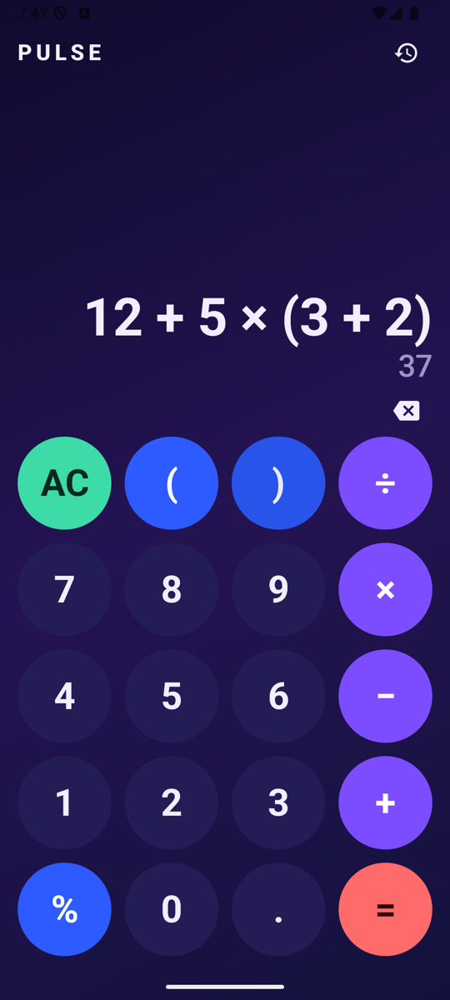
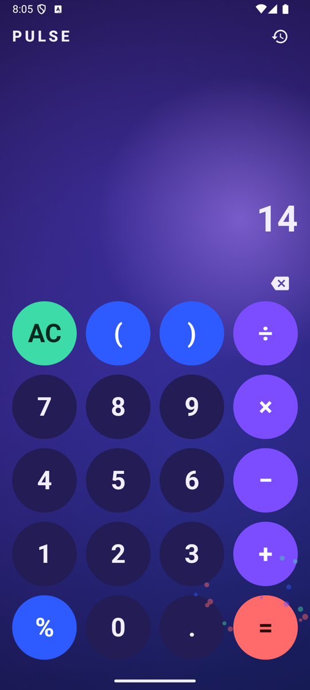
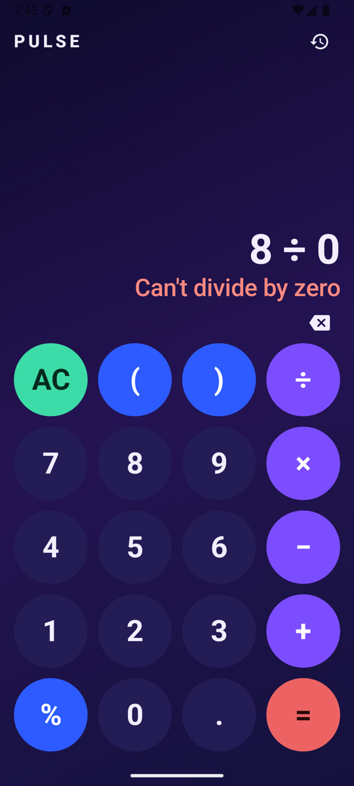
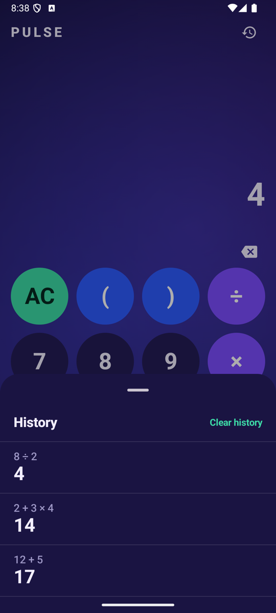

# Pulse

Pulse is a native Android calculator: colourful, expressively animated, with a real expression
engine (operator precedence, parentheses, percent), a live result preview, and a session-only
history.

- **Real expressions.** Type `12 + 5 × (3 + 2)` and see `37` before you press `=`.
- **Exact decimal maths.** All arithmetic uses `BigDecimal`: `0.1 + 0.2` is exactly `0.3`.
- **Live preview.** The result shows while you type, only when the expression is complete and valid.
- **Session history.** Newest first, at most 50 entries, kept across rotation and never written to disk.
- **Expressive but safe animation.** Animations are presentation only: input is never blocked or
  delayed, and with system animations off everything is instant and correct.
- **Accessible.** Every button has a description, results and errors are announced, text follows
  the system font size up to a cap.

## Screenshots

<p align="center">
  
  
  
  
</p>

The product, design and test decisions live in [`docs/`](docs):
[`PRODUCT_SPEC.md`](docs/PRODUCT_SPEC.md), [`TECHNICAL_DESIGN.md`](docs/TECHNICAL_DESIGN.md),
[`TEST_PLAN.md`](docs/TEST_PLAN.md). [`CLAUDE.md`](CLAUDE.md) holds the working rules for the
AI-assisted development of this project.

## Requirements

| What | Version |
|---|---|
| JDK | 17 or newer (built with Temurin 25) |
| Android SDK platform | `android-37.2` (compile SDK), installed through the SDK Manager |
| Min / target SDK | 26 / 36 |
| Gradle | 9.8.1 (the included wrapper downloads it) |
| Android Gradle Plugin / Kotlin | 9.4.1 / 2.4.21 |

Create a `local.properties` next to `settings.gradle.kts` pointing at your SDK (Android Studio
does this for you; the file is not committed):

```
sdk.dir=/path/to/Android/sdk
```

## Build

```bash
./gradlew assembleDebug     # app/build/outputs/apk/debug/app-debug.apk
./gradlew assembleRelease   # minified release build, see "Release build" below
```

Or open the folder in Android Studio and press Run.

## Tests

```bash
./gradlew testDebugUnitTest          # JVM unit tests: engine, input rules, ViewModel, formatting
./gradlew connectedDebugAndroidTest  # Compose UI tests; needs a running emulator or device
```

The unit tests cover every case in `docs/TEST_PLAN.md` sections 1 to 5. The UI tests cover section 6
plus accessibility, font scale, rotation and the history sheet. Section 7 of the test plan is a manual
checklist for each release candidate.

## Architecture

Single `app` module, Kotlin, Jetpack Compose, Material 3. No DI framework, no database, no network.

```
com.pulse.calculator
├── engine/   pure Kotlin, no Android imports
│             Tokenizer -> Parser (recursive descent) -> Evaluator (BigDecimal) -> EvalResult,
│             CalculatorEngine (facade) and NumberFormatter (display rules)
├── state/    CalculatorState, CalculatorAction, UiEvent,
│             InputEditor (pure Kotlin: every input rule), CalculatorViewModel
└── ui/       CalculatorScreen, display/ (expression and preview), keypad/, history/ (sheet),
              effects/ (background, particles, display effects), theme/ (colours, type, motion)
```

- **One direction of data.** The UI renders `CalculatorState` and sends `CalculatorAction`s to the
  `ViewModel`; it never computes maths. `InputEditor.apply` edits the expression string, the engine
  evaluates it, the result goes back into a `StateFlow`.
- **Internal expression format** is a plain string with ASCII operators (`+ - * /`); `×`, `÷`, `−`
  and thousands grouping are display only.
- **Events, not state, for effects.** Shake, result celebration and error pulse are one-shot
  `UiEvent`s from a `SharedFlow`; animations read state and events and never change them.
- **Reduced motion.** `ANIMATOR_DURATION_SCALE` of 0 turns every animation into an instant change and
  disables particles and the background drift (`LocalReducedMotion`).
- **History** lives in the `ViewModel` and is mirrored into `SavedStateHandle` (rotation-safe, not
  persisted to disk).
- All motion constants are in `ui/theme/Motion.kt`; all user-facing strings in `strings.xml`.

## Release build

The `release` build type has R8 minification and resource shrinking on.

```bash
./gradlew assembleRelease
```

- Without a signing key the result is `app/build/outputs/apk/release/app-release-unsigned.apk`,
  which cannot be installed.
- To sign it, create your own key (never commit it) and put `keystore.properties` next to
  `settings.gradle.kts`:

  ```
  storeFile=/absolute/path/to/pulse-release.jks
  storePassword=...
  keyAlias=pulse
  keyPassword=...
  ```

  `keystore.properties`, `*.jks` and `*.keystore` are git-ignored. With the file present,
  `./gradlew assembleRelease` produces a signed `app-release.apk`.
- **Keep `app/build/outputs/mapping/release/mapping.txt` for every version you ship.** It is the only
  way to read crash stack traces from a minified build. Keep the signing key and its passwords
  somewhere safe too: losing the key means you can no longer update the app.

Version is set in `app/build.gradle.kts` (`versionCode` must go up with every release).

## Known limitations (v1)

Portrait only, dark theme only, no scientific functions, no persistent history, no copy and paste,
no repeat-equals, no haptics. See section 11 of the product spec.

## License

[MIT](LICENSE) © 2026 Berkin Yilmaz
